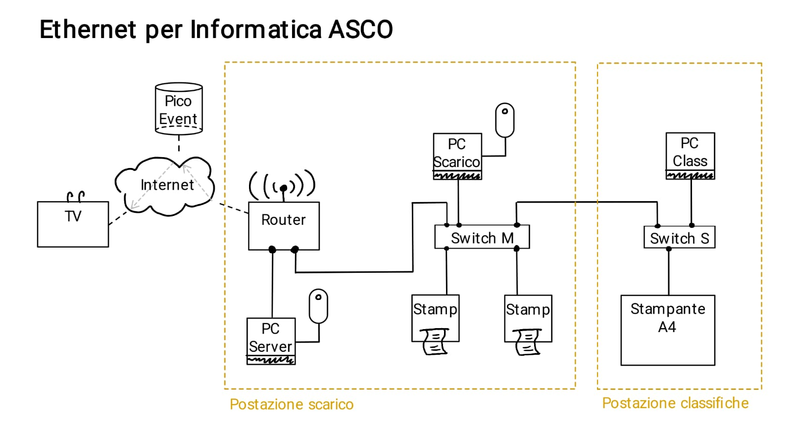

# Appunti informatica ASCO
## appunti
- non usare piu le TV
## lettura chip
- formato esteso 
- valutazione rapida su 'automatico', non 'nessuno'
## LAN e Router
- meglio usare gli switch piccoli, sono piu veloci
### Come ricaricare il credito
- aprire `chockpit.swisscom.ch`
- inserire `0792845531`
- accedere su `http://192.168.1.1`
- login con admin class1f1che
- aprire messaggi e cercare il messaggio con il codice
    - ( :warning: **se non appare magari l'inbox è piena**)
- caricare il credito di tasca propia :money_with_wings:

